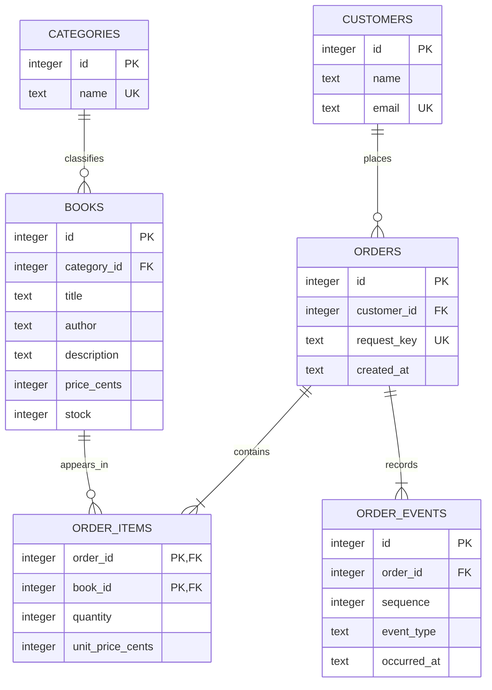

# Data Model: Book Catalog and Search

**Date**: 2026-11-24  
**Database**: Cloudflare D1 (SQLite)  
**Related spec**: [spec.md](spec.md)  
**Related plan**: [plan.md](plan.md)

## Design Rules

- Tables: `categories`, `books`, `customers`, `orders`, `order_items`, `order_events`.
- Runtime SQL values use bound parameters.
- Amounts are integer `_cents` fields. Decimal amounts and currency columns are prohibited.
- `books.stock` cannot be negative; `orders.request_key` is unique.
- Orders and books are M:N through `order_items`.
- Availability is derived from `books.stock > 0`.

## Entity-Relationship Diagram

## Relationship Cardinalities

| Relationship | Cardinality and rule |
|--------------|----------------------|
| Category–Book | One category has 0..N books; each book has exactly 1 category. |
| Customer–Order | One customer has 0..N orders; each order has exactly 1 customer. |
| Order–Order Item | One order has 1..N items; each item has exactly 1 order. |
| Book–Order Item | One book occurs in 0..N items; each item references exactly 1 book. |
| Order–Book | M:N through `order_items`; the junction stores quantity and purchase-time price. |
| Order–Order Event | One order has 1..N events; each event belongs to exactly 1 order. |

Foreign keys enforce child-to-parent relationships. Ordinary parent-side foreign keys cannot
enforce the minimum-one item/event rules, so purchase creation inserts the order, at least one
item, and its initial event in one transaction before commit.

## Tables and Constraints

### `categories`

| Field | Type | Nullability | Meaning |
|-------|------|-------------|---------|
| `id` | INTEGER | NOT NULL | Category identifier. |
| `name` | TEXT | NOT NULL | Category display name. |

- **PK**: `id`
- **FK**: none
- **UNIQUE**: `name` (plus PK uniqueness)
- **CHECK**: `name <> ''`

### `books`

| Field | Type | Nullability | Meaning |
|-------|------|-------------|---------|
| `id` | INTEGER | NOT NULL | Book identifier. |
| `category_id` | INTEGER | NOT NULL | Assigned category. |
| `title` | TEXT | NOT NULL | Searchable title. |
| `author` | TEXT | NOT NULL | Searchable author name. |
| `description` | TEXT | NOT NULL | Public description. |
| `price_cents` | INTEGER | NOT NULL | Current integer unit price in cents. |
| `stock` | INTEGER | NOT NULL | Current inventory count. |

- **PK**: `id`
- **FK**: `category_id → categories.id ON DELETE RESTRICT`
- **UNIQUE**: none beyond PK; distinct books may share a title
- **CHECK**: `title <> ''`; `author <> ''`; `price_cents >= 0`; `stock >= 0`

### `customers`

| Field | Type | Nullability | Meaning |
|-------|------|-------------|---------|
| `id` | INTEGER | NOT NULL | Customer identifier. |
| `name` | TEXT | NOT NULL | Display name. |
| `email` | TEXT | NOT NULL | Unique account email. |

- **PK**: `id`
- **FK**: none
- **UNIQUE**: `email` (plus PK uniqueness)
- **CHECK**: `name <> ''`; `email <> ''`

### `orders`

| Field | Type | Nullability | Meaning |
|-------|------|-------------|---------|
| `id` | INTEGER | NOT NULL | Order identifier. |
| `customer_id` | INTEGER | NOT NULL | Customer placing the order. |
| `request_key` | TEXT | NOT NULL | Request idempotency key. |
| `created_at` | TEXT | NOT NULL | Creation timestamp. |

- **PK**: `id`
- **FK**: `customer_id → customers.id ON DELETE RESTRICT`
- **UNIQUE**: `request_key` (plus PK uniqueness)
- **CHECK**: `request_key <> ''`; `created_at <> ''`

### `order_items`

| Field | Type | Nullability | Meaning |
|-------|------|-------------|---------|
| `order_id` | INTEGER | NOT NULL | Owning order. |
| `book_id` | INTEGER | NOT NULL | Purchased book. |
| `quantity` | INTEGER | NOT NULL | Purchased quantity. |
| `unit_price_cents` | INTEGER | NOT NULL | Purchase-time integer unit price. |

- **PK**: `(order_id, book_id)`
- **FK**: `order_id → orders.id ON DELETE RESTRICT`; `book_id → books.id ON DELETE RESTRICT`
- **UNIQUE**: composite PK prevents duplicate book lines; no additional UNIQUE constraint
- **CHECK**: `quantity > 0`; `unit_price_cents >= 0`

### `order_events`

| Field | Type | Nullability | Meaning |
|-------|------|-------------|---------|
| `id` | INTEGER | NOT NULL | Event identifier. |
| `order_id` | INTEGER | NOT NULL | Related order. |
| `sequence` | INTEGER | NOT NULL | Per-order event position. |
| `event_type` | TEXT | NOT NULL | Lifecycle event name. |
| `occurred_at` | TEXT | NOT NULL | Event timestamp. |

- **PK**: `id`
- **FK**: `order_id → orders.id ON DELETE RESTRICT`
- **UNIQUE**: `(order_id, sequence)` (plus PK uniqueness)
- **CHECK**: `sequence >= 1`; `event_type IN ('CREATED', 'CONFIRMED', 'CANCELLED')`;
  `occurred_at <> ''`

## 3NF Rationale

- Each relation represents one subject: category, book, customer, order, order line, or event.
- Category and customer facts are stored once and referenced by foreign keys.
- Order headers are separated from repeating book lines.
- `order_items` resolves Orders–Books M:N; `quantity` and `unit_price_cents` depend on the complete
  composite key `(order_id, book_id)`.
- Purchase-time `unit_price_cents` is distinct from the book's current `price_cents`.
- Repeating lifecycle history is isolated in `order_events`; `(order_id, sequence)` orders events.
- Availability is derived from stock, avoiding a duplicate fact.
- Order totals derive from `quantity * unit_price_cents`, avoiding redundant stored totals.
- `author` remains a book attribute because author metadata and multi-author books are out of scope.

Every non-key attribute depends on its key, the whole key, and no non-key attribute, satisfying 3NF
for the approved scope.

## Transaction and State Rules

- Purchase creation atomically inserts one order, one or more items, the initial `CREATED` event,
  and corresponding stock decrements.
- Stock decrement succeeds only with sufficient inventory; `CHECK (stock >= 0)` is the final
  database safeguard.
- Reusing a `request_key` cannot create a duplicate order.
- Events begin at sequence 1 and increase per order. Allowed stored types are `CREATED`,
  `CONFIRMED`, and `CANCELLED`; later purchase requirements define transition permissions.

## Deferred Implementation

This document defines the approved logical model only. It creates no SQL migrations, application
code, seed data, or tests.
