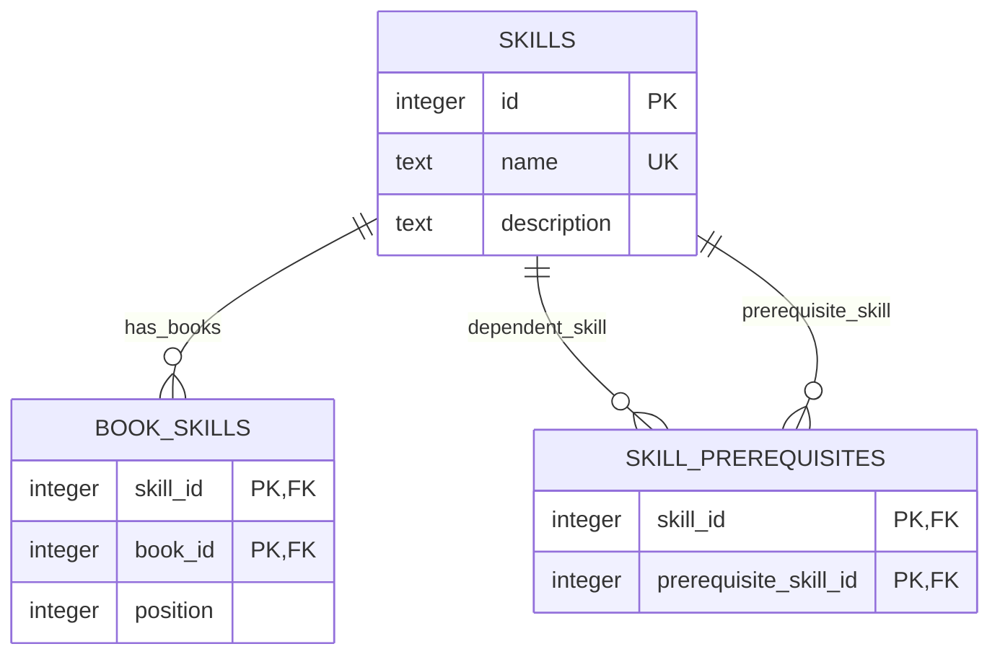

# Feature Specification: Personalized Learning Bookstore

**Feature Branch**: `004-personalized-learning`

**Created**: 2026-11-24

**Status**: Draft

**Input**: User description: "Customers pick a skill they want to learn and get existing D1 books in prerequisite order, with no duplicates or cycles."

## User Scenarios & Testing *(mandatory)*

### User Story 1 - Get a Prerequisite-Ordered Reading Path (Priority: P1)

A customer selects a skill and receives books associated with that skill and its transitive
prerequisites, ordered so prerequisite learning comes first.

**Why this priority**: The prerequisite-ordered reading path is the feature's primary customer
value and can be validated independently of any administration interface.

**Independent Test**: Create a known acyclic skill graph with books mapped to multiple skills,
request one target skill, and verify prerequisite ordering, valid D1 book references, and
deduplication.

**Acceptance Scenarios**:

- **AC-PL-01**: Books for prerequisite skills appear before books for dependent skills.
- **AC-PL-02**: Transitive prerequisites are included in prerequisite order.
- **AC-PL-03**: Every returned book corresponds to an existing row in D1 `books`.
- **AC-PL-04**: A book associated with multiple included skills appears only once.
- **AC-PL-05**: Books within one skill are ordered by `position`, then `book_id`.
- **AC-PL-06**: Independent prerequisite branches are ordered by `skill_id` for deterministic
  results.
- **AC-PL-07**: An existing skill with no associated books produces an empty list.
- **AC-PL-08**: An unknown skill produces a clear not-found outcome.
- **AC-PL-09**: A skill cannot be its own prerequisite.
- **AC-PL-10**: The same book-skill pair cannot be recorded twice.
- **AC-PL-11**: A prerequisite relationship that would create a direct or indirect cycle is
  rejected.

### Edge Cases

- The selected skill has no prerequisite skills.
- The selected skill or one of its prerequisites has no associated books.
- Multiple prerequisite branches converge on the same skill or book.
- A proposed relationship creates a cycle through more than one existing prerequisite edge.
- A referenced book does not exist in the authoritative D1 `books` table.

## Requirements *(mandatory)*

### Functional Requirements

- **FR-PL-001**: Customers MUST be able to select an existing skill by identifier.
- **FR-PL-002**: The system MUST include all transitive prerequisites of the selected skill.
- **FR-PL-003**: Every prerequisite skill MUST precede every skill that depends on it.
- **FR-PL-004**: Books within a skill MUST be ordered by `position`, then `book_id`.
- **FR-PL-005**: Results MUST contain only books referenced by existing D1 `books` rows.
- **FR-PL-006**: Each book MUST appear at most once in a result.
- **FR-PL-007**: When a book belongs to multiple included skills, it MUST appear at its earliest
  position in the prerequisite traversal.
- **FR-PL-008**: Self-prerequisite relationships MUST be rejected.
- **FR-PL-009**: Duplicate book-skill relationships MUST be rejected.
- **FR-PL-010**: Direct and indirect prerequisite cycles MUST be rejected.
- **FR-PL-011**: An unknown skill MUST produce a clear not-found outcome.

### Key Entities

- **Skill**: A learning objective with an identifier, unique name, description, associated books,
  and zero or more prerequisite skills.
- **Book Skill**: An association between one existing book and one skill, including the book's
  position within that skill's reading order.
- **Skill Prerequisite**: A directed relationship from a dependent skill to a prerequisite skill.

## Draft Data Model

Only the three extension tables are shown. `book_skills.book_id` references the existing D1
`books` table, which is intentionally omitted from this diagram.

### Draft Constraints

#### `skills`

- **PK:** `id`
- **FK:** None
- **UNIQUE:** `name`
- **CHECK:** `name <> ''`

#### `book_skills`

- **PK:** `(skill_id, book_id)`
- **FK:** `skill_id → skills.id`
- **FK:** `book_id → books.id`
- **UNIQUE:** `(skill_id, position)`
- **CHECK:** `position >= 1`
- The composite PK prevents duplicate book-skill pairs.

#### `skill_prerequisites`

- **PK:** `(skill_id, prerequisite_skill_id)`
- **FK:** `skill_id → skills.id`
- **FK:** `prerequisite_skill_id → skills.id`
- **UNIQUE:** The composite PK prevents duplicate prerequisite pairs.
- **CHECK:** `skill_id <> prerequisite_skill_id`
- A row-level CHECK prevents self-prerequisites. Direct and indirect cycles require transactional
  graph validation before accepting a relationship.

## Success Criteria *(mandatory)*

### Measurable Outcomes

- **SC-001:** 100% of returned books exist in D1.
- **SC-002:** 100% of prerequisite relationships are respected in generated reading paths.
- **SC-003:** No generated reading path contains a duplicate book identifier.
- **SC-004:** Self-prerequisites, duplicate book-skill pairs, and cycle-producing relationships are
  rejected in 100% of acceptance tests.
- **SC-005:** Repeating a request against unchanged data returns the same ordered book identifiers.
- **SC-006:** At least 95% of valid requests return a complete path or empty result within two
  seconds under the agreed acceptance workload.

## Assumptions

- Existing D1 `books` rows are authoritative; this feature never creates books.
- "Existing book" means a referenced `books` row exists. Stock filtering is outside this feature.
- Customer skill selections are not persisted.
- Skill administration interfaces, recommendations based on user history, semantic search,
  purchasing, migrations, and implementation code are outside this specification.
